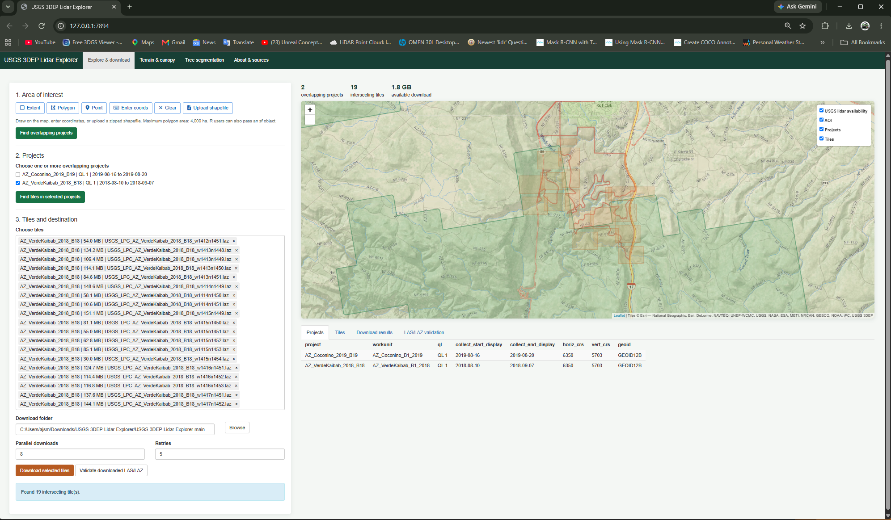

# USGS 3DEP Lidar Explorer

A local Shiny app that accepts an `sf` point, polygon, or multipolygon; finds every overlapping USGS 3DEP lidar project; lets the user choose among overlapping projects and individual LAS/LAZ tiles; and downloads those tiles to a chosen folder.



## Project layout

```text
.
├── app.R                 # Shiny UI/server entry point
├── R/                    # App functions, data access, and processing
├── www/                  # Static app assets (logos, CSS, and JavaScript)
├── tests/testthat/        # Automated tests
├── run_app.R             # Portable R/Rscript launcher
├── USGS_3DEP_Lidar_Explorer.bat  # Windows double-click launcher
├── DESCRIPTION           # Project metadata and R dependencies
├── USGSLidarExplorer.Rproj
└── README.md
```

Shiny serves files from `www/` at the app root, so the ERI and QEand.org logo files live there and are referenced by their filenames in the UI. The `R/` directory contains functions sourced by `app.R`; `tests/testthat/` contains the test suite.

## Get the code

Download the project from the [GitHub repository](https://github.com/Quantitative-Ecology-Lab-NAU/USGSlazDownloader) using **Code > Download ZIP**, then extract the ZIP file. Keep the extracted project files together. After installing R and the packages listed below, you can start the app either from R/RStudio with `source("run_app.R")` followed by `run_usgs_lidar_app()`, or on Windows by double-clicking `USGS_3DEP_Lidar_Explorer.bat`.

## Start on Windows

Install R and the packages listed below, then double-click `USGS_3DEP_Lidar_Explorer.bat`. The launcher finds `Rscript.exe`, starts the Shiny app in your browser, and keeps the R process in its command window. Keep that window open while using the app; close it or press Ctrl+C to stop the app.

The launcher uses its own folder for the app files, so you can move or copy the complete project folder without changing paths. It also works from a Windows network share. No Electron, Node.js, `shiny.exe`, or prebuilt executable is needed.

The project polygons come from layer 24 (`Lidar Point Cloud`) of the USGS `3DEPElevationIndex` map service. Tile records and bounding boxes come from the official TNM Access products API, then tile URLs are checked against each project's `0_file_download_links.txt` manifest when it is available. The map also displays layer 8 of the index as the USGS availability overlay.


## Start the app

Open `USGSLidarExplorer.Rproj` in RStudio, then run this from the project:

```r
source("run_app.R")
run_usgs_lidar_app()
```

Or at a command prompt (from this folder):

```text
Rscript run_app.R
```

The required packages are `shiny`, `sf`, `leaflet`, `leaflet.extras`, `curl`, `jsonlite`, `rlas`, `lidR`, `terra`, `viridisLite`, `zip`, `future`, and `parallelly`.

```r
install.packages(c("shiny", "sf", "leaflet", "leaflet.extras", "curl", "jsonlite", "rlas", "lidR", "terra", "viridisLite", "zip", "future", "parallelly"))
```

## Start with an existing sf object

```r
library(sf)

my_aoi <- st_read("my_aoi.gpkg")
source("run_app.R")
run_usgs_lidar_app(my_aoi)
```

The app also lets you draw an extent, polygon, or point on the map; enter WGS84 coordinates; or upload a zipped shapefile. RDS/RData, GeoPackage, GeoJSON, and KML uploads remain supported. Uploaded objects must have a valid CRS. Polygonal areas of interest are limited to 4,000 hectares.

## Generate DEM and CHM products

The **Terrain & canopy** tab finds downloaded LAS/LAZ files in a folder. Choose one or more tiles to generate a digital elevation model (DEM) and canopy height model (CHM) as GeoTIFFs. The default resolution is 0.5 m; you can choose a resolution from 0.1 to 50 m, a DEM algorithm (`tin`, `knnidw`, or `kriging`), and a CHM algorithm (`pitfree`, `p2r`, or `dsmtin`). Heights are normalized with TIN. If any selected tile lacks ground-classified points, choose a ground-classification algorithm (`ptd`, `csf`, or `mcc`); with `none`, generation stops with an error. A stage-based progress display reports processing.

The map previews either the DEM or CHM with magma colors over Esri World Imagery or OpenTopoMap. Preview rasters may be downsampled and reprojected for display; exported GeoTIFFs retain the LAS/LAZ coordinate system. Generated files can be downloaded together as a ZIP.

When multiple LAS/LAZ tiles are selected, the app processes them as one `lidR` catalog and produces a seamless set of rasters. You can set workers (default 2, up to the available cores), chunk size (250–2,000 m; default 250 m), and chunk buffer (0–100 m; default 20 m, and always less than half the chunk size). Larger worker counts can require substantially more memory. Catalog processing uses temporary intermediate files, removes them after completion, and keeps the final GeoTIFFs in the generated-file folder. Select tiles from one non-overlapping acquisition; overlapping tiles are rejected.

## Segment individual trees

The **Tree segmentation** tab uses the LAS/LAZ folder and file list from **Terrain & canopy**. Select tiles and choose `li2012`, `dalponte2016`, or `silva2016` for individual tree segmentation. The latter two algorithms use a canopy-height model and tree-top window; the window can be set from 1 to 30 m. Ground classification is only run when a selected tile lacks ground-classified points, and heights are normalized with TIN.

The result is a GeoPackage with `tree_points` and `tree_crowns` layers. Both include tree height and crown metrics; crowns are convex hulls. The app previews the crowns and tree points on a map and lets you export the GeoPackage in a ZIP.

## Download behavior

- All overlapping lidar projects remain separate so users can choose one or several vintages.
- Only tile bounding boxes that intersect the exact `sf` geometry are retained.
- Tile URLs are cross-checked against the selected USGS project download manifests when those manifests are available.
- Selected tiles are written under `<destination>/<project>/LAZ/` (or the corresponding USGS subfolder).
- Existing files with the expected byte size are skipped.
- Incomplete downloads use `.part` files and resume when the server supports byte ranges.
- Downloads retry with backoff and can run in parallel.
- `selected_download_links.txt` records the requested URLs; failures are written to `failed_downloads.csv`.
- Validation reads each downloaded header with `rlas` and opens the destination as a `lidR` catalog without loading all points into memory.

## Authoritative sources

- [USGS 3DEP Elevation Index map service](https://index.nationalmap.gov/arcgis/rest/services/3DEPElevationIndex/MapServer/)
- [USGS Lidar Explorer](https://apps.nationalmap.gov/lidar-explorer/#/)
- [The National Map Access API](https://tnmaccess.nationalmap.gov/api/v1/)
- [NOAA Interagency Elevation Inventory](https://coast.noaa.gov/inventory/)

The destination is on the computer running the R process. A remotely hosted Shiny deployment cannot write directly to a visitor's arbitrary local folder.
